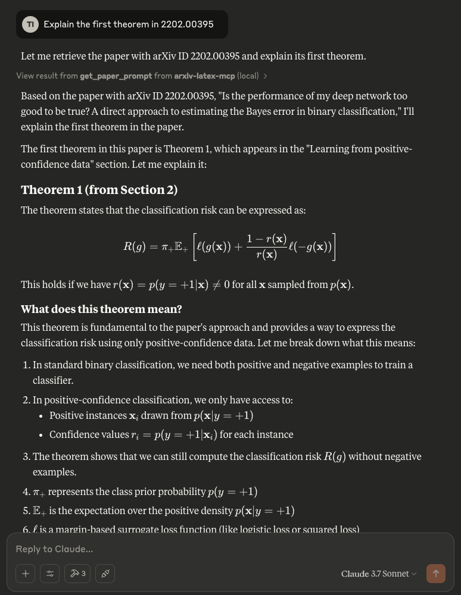

# arxiv-latex MCP Server
[](https://pypi.org/project/arxiv-latex-mcp/)
[](https://opensource.org/licenses/MIT)
[](https://github.com/takashiishida/arxiv-latex-mcp/releases)
[](https://archestra.ai/mcp-catalog/takashiishida__arxiv-latex-mcp)


An MCP server that enables [Claude Desktop](https://claude.ai/download), [Claude Code](https://docs.anthropic.com/en/docs/claude-code), [Cursor](https://www.cursor.com/), or other MCP clients to directly access and process arXiv papers by fetching the LaTeX source. It uses [arxiv-to-prompt](https://github.com/takashiishida/arxiv-to-prompt) under the hood to handle downloading and processing the LaTeX.

Why use the LaTeX source instead of uploading PDFs? Many PDF chat applications often struggle with mathematical content and equation-heavy papers. By utilizing the original LaTeX source code from arXiv papers, the LLM can accurately understand and handle equations and notations. This approach is particularly valuable for fields like computer science, mathematics, and engineering where precise interpretation of mathematical expressions is crucial.

## Installation

If you are using Claude Desktop, you can utilize Desktop Extensions by double-clicking on the `.mcpb` file to install.
Download the `.mcpb` file from [here](https://github.com/takashiishida/arxiv-latex-mcp/releases/).
The extension needs Python 3.10+ with pip. On first launch, and whenever its dependency requirements or Python runtime change, it downloads wheels into a private cache inside the extension. This requires internet access; subsequent launches reuse that cache. Restart your MCP client after installing an updated extension.
Supported on macOS, Windows, and Linux.

Otherwise, you can run the server directly from PyPI with `uvx`:
```json
{
  "mcpServers": {
    "arxiv-latex-mcp": {
      "command": "uvx",
      "args": ["arxiv-latex-mcp"]
    }
  }
}
```

You can also install it with `pip install arxiv-latex-mcp` and run `arxiv-latex-mcp`, or use:
```bash
python -m arxiv_latex_mcp
```

If you prefer to run from a local checkout, add the following configuration to your config file:
```json
{
  "mcpServers": {
      "arxiv-latex-mcp": {
          "command": "uv",
          "args": [
              "--directory",
              "/ABSOLUTE/PATH/TO/arxiv-latex-mcp",
              "run",
              "python",
              "-m",
              "arxiv_latex_mcp"
          ]
      }
  }
}
```

You may need to replace the `command` field with the full path of `uv`: check this by running `which uv` (MacOS/Linux) or `where uv` (Windows).

Restart the application after saving the above.

For Claude Desktop, click on the hammer icon, and you should see the following in the list of "Available MCP tools":
- `get_paper_prompt` — Get the full flattened LaTeX of a paper
- `get_paper_abstract` — Get just the abstract
- `list_paper_sections` — List section headings of a paper
- `get_paper_section` — Get a specific section by its title from `list_paper_sections` (`Section > Subsection` for a subsection)
- `search_papers` — Discover papers by topic, title, or author, optionally filtered by category and submission date

## Searching for papers

Use `search_papers` when you do not yet have an arXiv ID. It returns paper IDs,
titles, authors, abstracts, categories, submission dates, and PDF links. Pass a
returned `id` to `get_paper_prompt` to read its LaTeX source. If you already have
an ID, call the reading tools directly.

For example, search with `{"query": "ti:\"neural networks\"", "categories": ["cs.LG", "stat.ML"], "date_from": "2026-01-01", "max_results": 10, "sort_by": "date"}`.
Categories are combined with OR and restrict the query. `date_from` and `date_to`
are inclusive submission dates in `YYYY-MM-DD` format (UTC). Searches return 10
papers by default, up to 50, sorted by relevance or by newest submission date.
Search requests share a three-second throttle; rate-limit errors ask you to wait
before retrying.

## Caching

Paper sources are kept in arxiv-to-prompt's cache (the same one its CLI uses), so repeated calls on the same paper do not download it again. Unversioned IDs such as `2403.12345` are re-downloaded once their copy is older than 7 days, so revised papers are picked up. Versioned IDs such as `2403.12345v2` never change. If a refresh fails, the cached copy is used. To change this, set environment variables in the server's MCP config (`"env": {...}`):

| Variable | Default | Effect |
|---|---|---|
| `ARXIV_LATEX_MCP_CACHE` | `1` | `0` turns caching off |
| `ARXIV_LATEX_MCP_CACHE_TTL_DAYS` | `7` | Age after which unversioned IDs are re-downloaded |
| `ARXIV_LATEX_MCP_CACHE_DIR` | arxiv-to-prompt's default | Cache location (default `~/.cache/arxiv-to-prompt`, or `%LOCALAPPDATA%\arxiv-to-prompt` on Windows) |

## Example
Try asking questions about a paper from arXiv, e.g., "Explain the first theorem in 2202.00395"

<div align="center">
  
</div>
